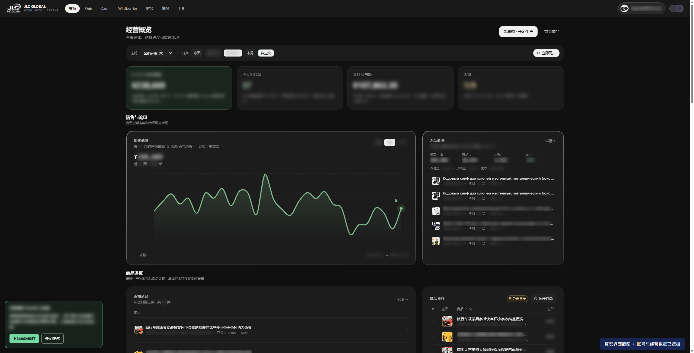
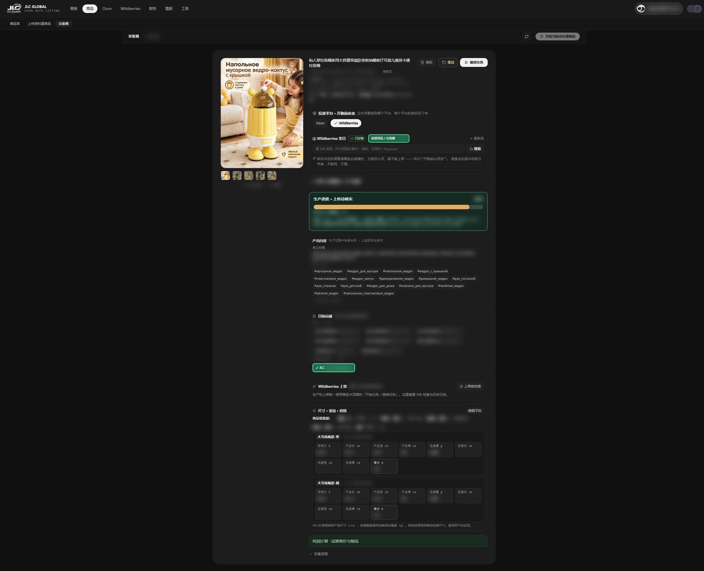
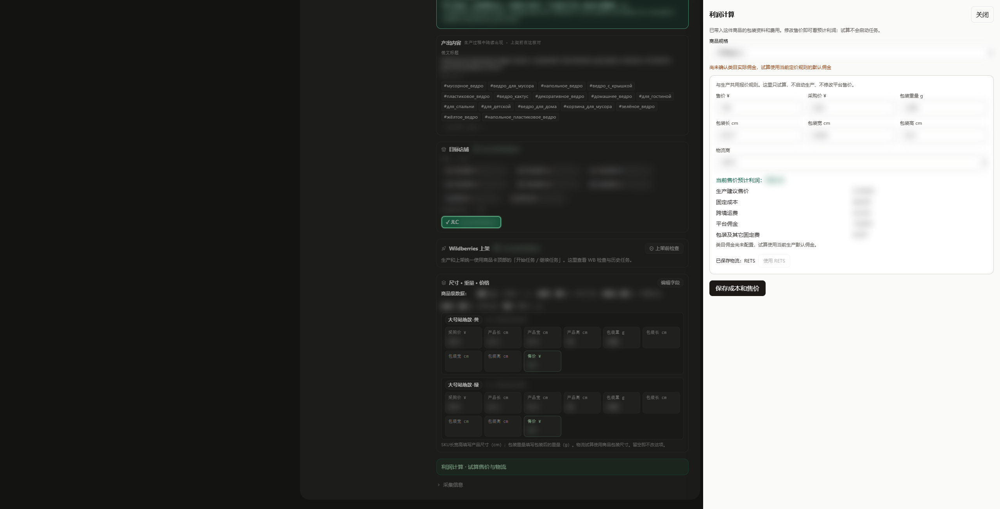
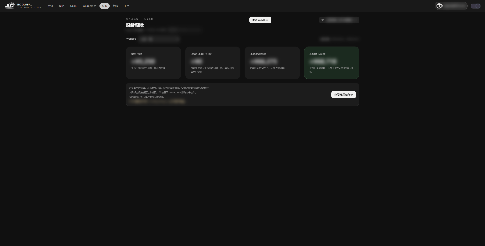
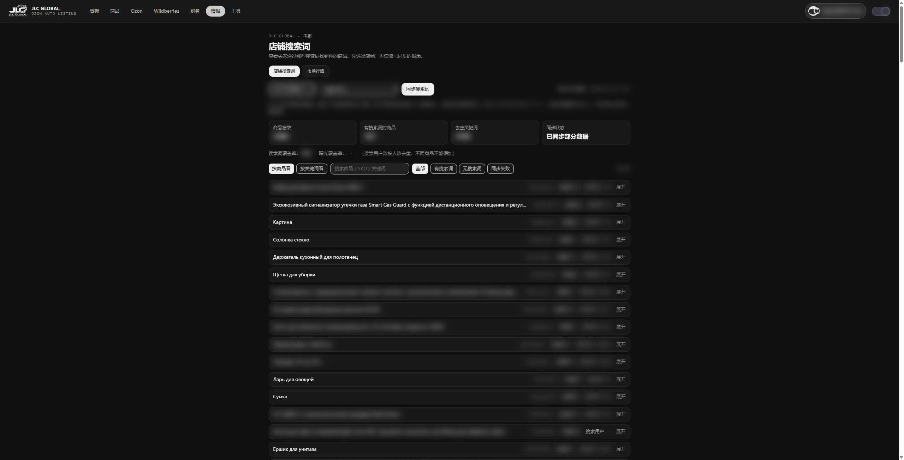
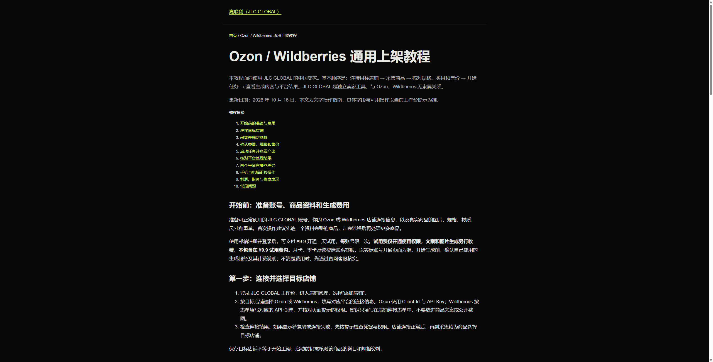

# 嘉联创 JLC GLOBAL｜跨境商品上架与店铺经营工作台

**面向中国卖家的 Ozon / Wildberries / Yandex 跨境上架工具。把商品资料、俄语文案、图片制作、上架任务和经营信息放在同一个云端工作台。**

[访问官网](https://jlcpro.cn/) · [完整上架教程](https://jlcpro.cn/guides/listing.html) · [Ozon 说明](https://jlcpro.cn/guides/ozon.html) · [Wildberries 说明](https://jlcpro.cn/guides/wildberries.html)

中文品牌名是 **嘉联创**，不是“嘉立创”。本页由产品方整理。本仓库提供产品文档、截图及官网公开页面快照，不包含完整云端业务源码。

*真实工作台截图，账号及主要经营数字已遮挡。截图用于展示功能，不代表使用效果或收益承诺。*

## 官网门户

*2026-10-16 官网优化时保存的门户页截图。*

## 适合怎样的工作

你有商品来源和目标店铺，需要把中文商品资料整理成俄语内容，核对规格、类目和价格，再提交到跨境平台。嘉联创把这些环节放进同一条工作流程，方便跟踪每件商品目前走到了哪一步。

- **多规格商品**：集中核对每个 SKU 的图片、尺寸、包装重量与售价。
- **俄语商品内容**：制作标题、简介、标签及图片，上架前检查是否符合实物。
- **多平台经营**：按目标平台确认店铺、类目和必填属性，分别核对提交结果。
- **手机与电脑衔接**：手机处理已进入云端的商品和查看进度，回到电脑继续工作。
- **经营复盘**：从看板进入财务、商品表现和搜索词页面，结合更新时点与覆盖范围判断下一步。

## 从商品资料到上架

### 1. 采集并核对商品

在支持的浏览器环境中使用插件采集 1688 商品，再到采集箱核对名称、源图和规格。工作台也提供“上传资料建商品”入口，支持的资料类型以页面提示为准。

采集只是准备好资料。材质、用途、尺寸、重量仍需结合实物核实，源图使用权也需自行确认。

### 2. 选择平台、类目和店铺

先明确商品投放的平台与店铺，再核对类目及必填属性。Ozon 与 Wildberries 的类目、凭据和回执分别处理，不能直接把一个平台的设置当作另一个平台的设置。

### 3. 查看图片、文案和生产进度

生产页集中展示商品图片、平台选择、任务进度、俄文标题、标签和目标店铺。生成后应检查图片与文案是否准确描述实物，尤其是材质、功能、尺寸及图片中的文字。

*真实生产页面，账号、店铺标识和部分商品数据已遮挡。截图中的任务为“上传待核实”，用于说明进度及核对界面，不表示商品已成功上架。*

### 4. 核对规格，做好利润预算

在尺寸、重量和价格区域核对各规格，再用利润计算试算售价与物流。这样可以在提交前检查成本与定价，而不是等商品发出后再估算。

**预计利润不等于实际利润**，试算依赖填写的采购成本、售价、物流和所用费用条件。实际经营还需结合平台结算、退款和真实支出核对。

*真实利润计算窗口，成本和计算结果已遮挡。当前商品尚未配置实际类目佣金，页面提示采用默认佣金，因此预算仍需核对。*

### 5. 启动任务并检查平台结果

确认并保存资料后再开始任务。“开始任务”可能继续向店铺提交商品，并非只生成预览。图片生成完成、提交到平台、审核通过和商品可售是不同阶段。

遇到结果未知或待核实，先检查原任务与平台后台，避免重复提交。重试、继续等入口应结合任务提示使用。

## 手机随时处理，电脑继续工作

已采集到云端的商品，可以通过手机进入工作台处理、启动上架任务并查看进度。回到电脑后登录同一账号，继续查看和处理同一份云端资料；切换设备前确认修改已保存。

手机适合随时处理任务，电脑适合核对较多规格和查看经营报表。采集插件需要支持的浏览器环境，云端手机操作并不代表手机具备所有桌面插件能力。财务和搜索数据建议在电脑端查看。

## 上架之后，还能看什么

### 经营看板

看板提供销售概览、趋势、近期商品和产品表现入口。结合店铺和日期范围查看，再进入相应商品或报表核对。不同区域的统计口径、更新时间以页面说明为准。

### Ozon 财务报告与对账

按结算周期查看卖出金额、平台本期付款、期初与期末余额，帮助分清订单金额、平台余额和实际到账。

*真实财务页面，金额、店铺和账号已遮挡。截图保留了同步不完整提示；使用报表时应先检查数据是否齐全。*

这里是平台结算，**采购成本尚未扣除，不能直接当作商品净利润**。银行实际到账还需核对收款记录，人民币折算受设置汇率影响。目前页面展示 Ozon，Wildberries 财务尚未接入。

### 店铺搜索情况与关键词

看板可以查看搜索进店、商品页访问、加购及成交等可用指标。当前“情报”页还提供 **店铺搜索词**，可选择店铺，按商品或按关键词查看已同步报表。

*真实情报页面，店铺、标识及经营数字已遮挡。截图时该店铺只同步了部分数据。*

搜索词来自 Ozon 官方报表，页面提示成功数据区间、同步状态与覆盖范围。最近数据可能仍在计算，部分 SKU 有数据不代表覆盖全店，搜索用户数也不能简单跨商品相加。这是自己店铺的经营信息，不等同于全市场关键词搜索量或实时排名查询。

## 平台与功能范围

| 平台 | 当前介绍范围 |
| --- | --- |
| Ozon | 商品上架，以及本页展示的财务对账、商品搜索表现与搜索词 |
| Wildberries | 商品建卡与上架，按 WB 类目、属性及回执核对；财务尚未接入 |
| Yandex | 产品方确认支持的上架平台，具体以当前工作台及客服说明为准；本页未展示 Yandex 操作截图 |

## 新用户怎么开始

1. 访问官网，注册并登录账号。
2. 确认使用权限与生成费用，连接目标店铺。
3. 先选一个资料完整的商品，完成采集与核对。
4. 确认平台、类目、店铺、必填属性、尺寸、重量和售价。
5. 启动任务，检查文案、图片与处理进度。
6. 核对平台结果，再继续处理更多商品。

[完整文字教程](https://jlcpro.cn/guides/listing.html)覆盖店铺连接、采集、规格确认、任务启动、结果核对和手机与电脑衔接。

## 费用说明

邮箱注册登录后，可支付 **¥9.9 开通一天试用，每账号限一次**。试用费只开通使用权限，**文案和图片生成另行收费**。月卡、季卡、续费与具体生成费用以当前开通页面和官网客服说明为准。

## 常见问题

**这是完整开源系统吗？** 不是。本仓库是产品资料和公开页面快照，完整服务通过官网使用。

**图片生成完成就算上架成功吗？** 不算，还需检查平台接收、审核及可售状态。

**可以保证利润或排名吗？** 不能。工具帮助整理资料、执行流程和查看信息，实际结果取决于商品、价格、市场、平台规则和经营情况。

**截图可以用来预测我的收益吗？** 不可以。截图用于说明界面，真实经营数字已经遮挡。

---

产品名称：嘉联创（JLC GLOBAL） · [官网](https://jlcpro.cn/) · 图文更新：2026-10-16。

本页为产品方介绍，与 Ozon、Wildberries、Yandex 无隶属关系。功能以当前账号界面为准。截图来自实际浏览器页面；遮挡仅影响截图显示，没有修改服务端数据。官网公开页面快照见 [website](website/README.md)。
